<a id="readme-top"></a>

<p align="center">
  <a href="https://www.mianshiya.com"></a>
</p>

<h1 align="center">面试鸭 - 程序员面试刷题神器</h1>

<p align="center">
  <b>300+ 题库、1w+ 道企业高频面试真题与原创题解，覆盖 Java 后端、AI 应用开发、前端、Python、Go、C++ 等主流方向。</b><br>
  网页 · 小程序 · IDE 插件 · VSCode 插件四端刷题，帮你用更短的时间准备面试，拿到满意的 Offer！
</p>

<p align="center">
  <a href="https://www.mianshiya.com"></a>
  <a href="https://www.mianshiya.com/category/hot"></a>
  <a href="https://www.mianshiya.com"></a>
  <a href="https://www.mianshiya.com/?category=ai"></a>
  <a href="https://yuyuanweb.yuque.com/org-wiki-yuyuanweb-zvq1bg/oue2nx/ddldaca2a6g14a0p"></a>
  <a href="https://github.com/liyupi/mianshiya"></a>
</p>

<p align="center">
  <a href="https://www.mianshiya.com"><b>▶ 立即免费刷题</b></a> &nbsp;·&nbsp;
  <a href="https://www.mianshiya.com/getoffer">30 天面试通关特训营</a> &nbsp;·&nbsp;
  <a href="https://bilibili.com/video/BV14E421w7dr/">视频介绍</a> &nbsp;·&nbsp;
  <a href="https://yuyuanweb.yuque.com/org-wiki-yuyuanweb-zvq1bg/oue2nx/glupqzb1xry49475">使用文档</a>
</p>

<p align="center">
  <a href="https://www.mianshiya.com">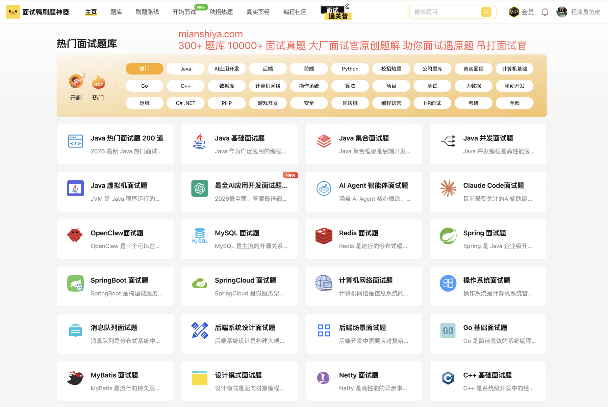</a>
</p>

**面试鸭**（官网 [mianshiya.com](https://www.mianshiya.com)）是程序员鱼皮带团队打造、上海鱼鸢网络技术有限公司运营的程序员面试刷题平台，2024 年上线全新版本，至今持续更新。面试鸭把企业高频面试题（俗称「八股文」）按岗位和考点系统整理成 300+ 题库、1w+ 道真题，每道题都配有大厂面试官参与打磨的原创题解，支持网页端、微信小程序、JetBrains IDE 插件和 VSCode 插件四端同步刷题。

无论你是准备实习、校招、社招的程序员，还是想转型 AI 应用开发的开发者，都可以在面试鸭一站式完成「找题 → 刷题 → 自测 → 模拟面试」的备战流程。除了 Java、MySQL、Redis、Spring 等经典八股文，面试鸭还紧跟趋势上线了 AI Agent、RAG、Claude Code、LangChain 等 AI 面试题库，并收录美团、阿里、腾讯、字节跳动等大厂真实面经。

**快速导航：** [项目背景](#项目背景) · [面试鸭有哪些优势](#面试鸭有哪些优势) · [热门面试题库](#热门面试题库) · [刷题路线](#刷题路线) · [核心功能](#核心功能) · [适合哪些人](#适合哪些人) · [开源版说明](#开源版说明) · [常见问题](#常见问题)


## 项目背景

如今面试越来越卷，每场技术面试都必考八股文。但大家准备时总会遇到这些问题：

- 网上的面试题太分散，不知道从哪找、该背哪些？
- 很多面经只有问题没有答案，题解质量参差不齐，也不知道对不对？
- 网上的面试题 PDF 大多是用来引流的，题目不全，也很久没人维护？
- 八股文太多背不完，背了就忘，一到面试还是说不出来？

自己从零整理题目、搜题解、辨别对错，少说也要花几十个小时。所以我们做了面试鸭：**题目更全面、刷题更方便、背题更省时、题解更优质、知识更丰富、更新更频繁**。目标只有一个：帮助大家用更短的时间准备面试，在面试中遇到原题！


## 面试鸭是什么？

面试鸭（mianshiya.com）是鱼皮带团队打造的程序员面试刷题平台，覆盖几乎所有主流编程方向，包括 Java 后端 / 前端 / AI 大模型 / Python / C++ / Go / 运维 / 测试 / 系统设计 / 场景题 / 公司题库 / HR 面试，300+ 题库、10000+ 高频面试真题，帮程序员高效备战面试。


## 面试鸭有哪些优势？

### 1. 四端同步，刷题更方便

支持网页端、微信小程序、JetBrains IDE 插件、VSCode 插件，学习数据全端同步，随时随地刷题。界面纯净，「沉浸模式」一键隐藏多余元素，一题接一题专注刷题。

<p align="center">
  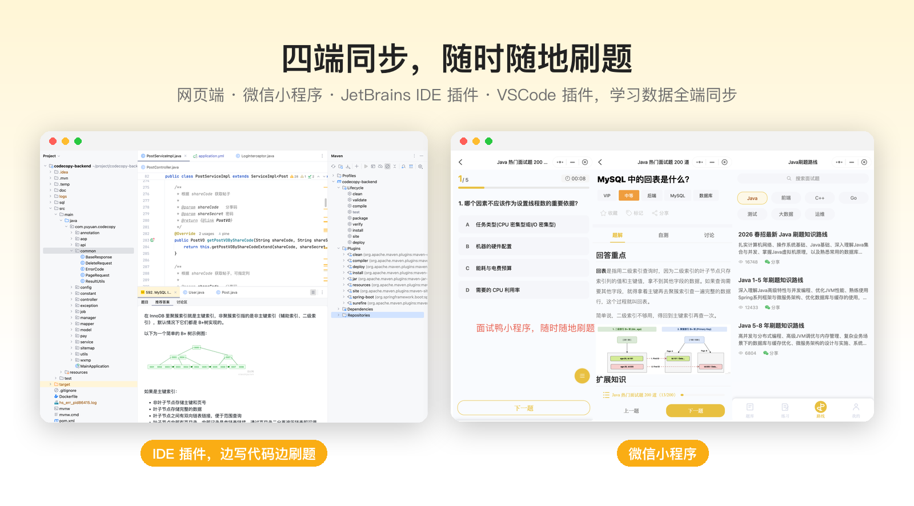
</p>

### 2. 题目全面，命中率高

300+ 题库、1w+ 道高频面试题，按岗位和考点系统划分，收录企业真实面试新题和大厂真实面经，去掉过时题和错题，让你在面试中遇到原题。

<p align="center">
  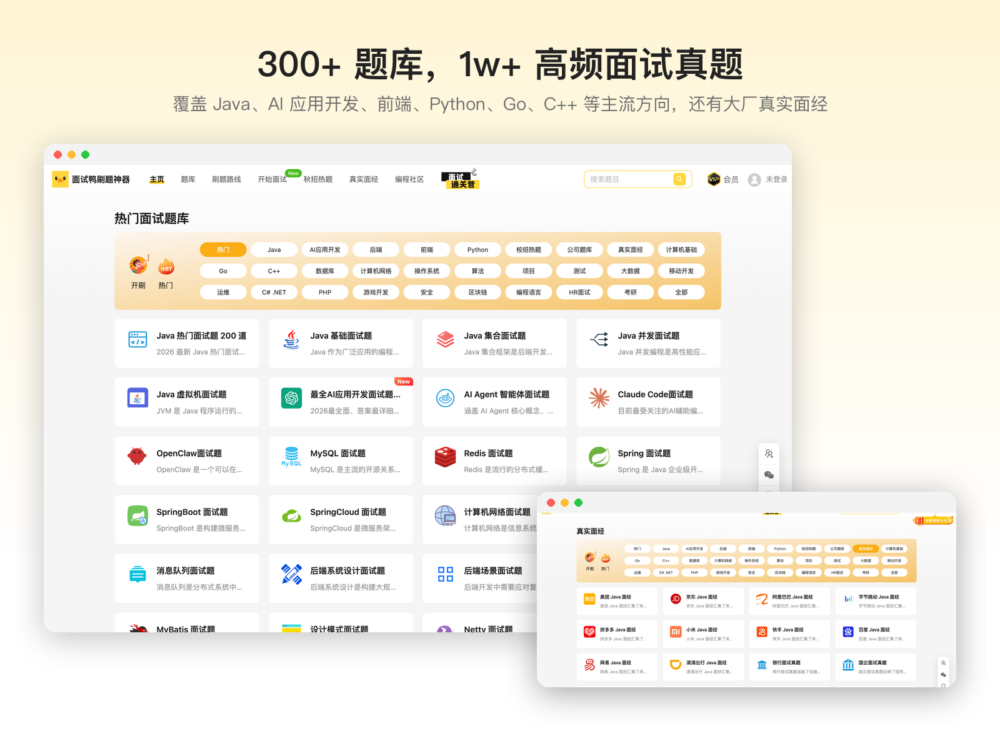
</p>

### 3. 题解更优质

多位大厂面试官参与创作和打磨题解：先给出「回答重点」，可以直接用于面试作答；再结合实战经验给出「扩展知识」，应对面试官追问。很多题解都可以当技术文章来学习。

<p align="center">
  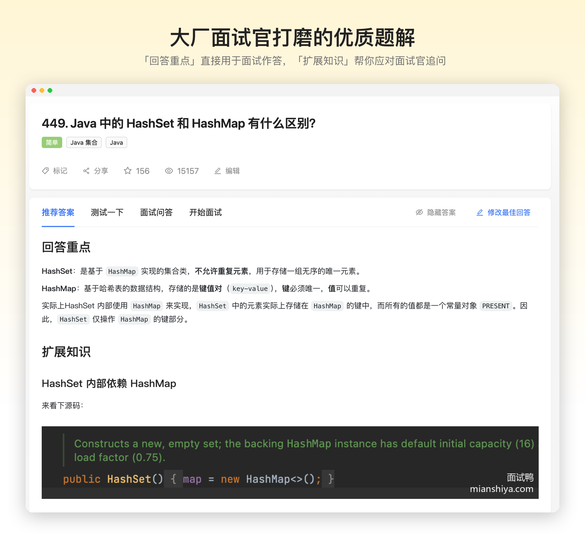
</p>

### 4. 紧跟趋势，更新频繁

面试鸭持续更新内容，优化系统功能。AI 方向已经上线 AI 应用开发、AI Agent 智能体、RAG、Claude Code、OpenClaw 等题库，及时覆盖当下企业面试的新考点。

<p align="center">
  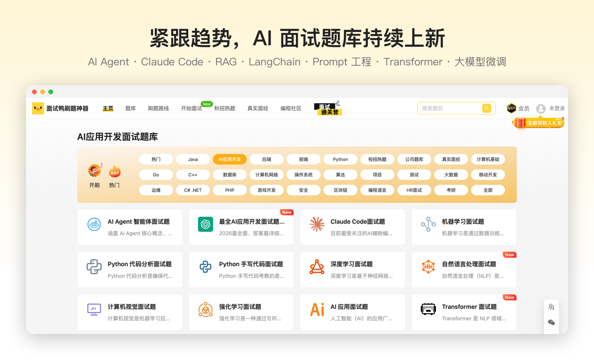
</p>

<p align="right"><sub><a href="#readme-top">↑ 回到顶部</a></sub></p>


## 热门面试题库

> 以下为部分热门题库，更多请访问 [面试鸭全部题库](https://www.mianshiya.com/category/hot)

### 🤖 AI 应用开发 / 大模型面试题

| 题库 | 内容 |
| --- | --- |
| [AI 应用开发面试题库（含详细答案）](https://www.mianshiya.com/bank/1906189461556076546) | 大模型原理、RAG 检索增强生成、Agent 智能体开发、Prompt 工程、LangChain、向量数据库、模型微调与部署 |
| [AI Agent 智能体面试题](https://www.mianshiya.com/bank/2052284728362414082) | Agent 核心概念、MCP / A2A 协议、Tool Calling、ReAct、Agent Loop、多 Agent 协作、记忆机制、上下文管理 |
| [Claude Code 面试题](https://www.mianshiya.com/bank/2082027801073975298) | Agentic Coding、Agent Loop 原理、CLAUDE.md 规则文件、上下文压缩、工具调用、权限系统、子代理并行 |
| [OpenClaw 面试题](https://www.mianshiya.com/bank/2031640554575519745) | 可在本地设备运行的个人 AI 助手，2026 年现象级 AI Agent |
| [AI 超级智能体项目面试题](https://www.mianshiya.com/bank/1929747035048828930) | 基于 Spring AI 的 AI 应用与 ReAct 自主规划智能体项目实战，涵盖 RAG 知识库、工具调用、MCP 服务 |

此外还有 AI 大模型原理和应用、LangChain、Prompt 提示词工程、RAG 检索增强生成、Transformer、机器学习、深度学习、自然语言处理、大模型微调等题库。

### ☕ Java 后端面试题

| 分类 | 题库 |
| --- | --- |
| Java 核心 | [Java 热门面试题 200 道](https://www.mianshiya.com/bank/1860871861809897474)、[Java 基础](https://www.mianshiya.com/bank/1787463103423897602)、[Java 集合](https://www.mianshiya.com/bank/1788408712975282177)、[Java 并发](https://www.mianshiya.com/bank/1789249312885223425)、[Java 虚拟机 JVM](https://www.mianshiya.com/bank/1789931432793948162) |
| 主流框架 | [Spring](https://www.mianshiya.com/bank/1790683494127804418)、[SpringBoot](https://www.mianshiya.com/bank/1797452903309508610)、[SpringCloud](https://www.mianshiya.com/bank/1797453053310402561)、[MyBatis](https://www.mianshiya.com/bank/1801424748099739650)、[Netty](https://www.mianshiya.com/bank/1804354610222800897) |
| 数据库与中间件 | [MySQL](https://www.mianshiya.com/bank/1791003439968264194)、[Redis](https://www.mianshiya.com/bank/1791375592078610434)、[消息队列](https://www.mianshiya.com/bank/1801255316257841153)、[RabbitMQ](https://www.mianshiya.com/bank/1850081848441466881)、[MongoDB](https://www.mianshiya.com/bank/1837028071614509057)、[Nginx](https://www.mianshiya.com/bank/1824363422328864769) |
| 系统设计与场景 | [后端系统设计](https://www.mianshiya.com/bank/1795650093939204097)、[后端场景题](https://www.mianshiya.com/bank/1795650132375805954)、[设计模式](https://www.mianshiya.com/bank/1801559627969929217) |

### 💻 计算机基础面试题

[计算机网络](https://www.mianshiya.com/bank/1790948499480616961)、[操作系统](https://www.mianshiya.com/bank/1790684063773007874)、[算法和数据结构](https://www.mianshiya.com/bank/1824727406021644290)、[数据结构](https://www.mianshiya.com/bank/1824727630718898177)、[Git 基础](https://www.mianshiya.com/bank/1815649049726590977)、考研 408

### 🌐 前端面试题

[前端热门面试题 200 道](https://www.mianshiya.com/bank/1860931478862618626)、[JavaScript](https://www.mianshiya.com/bank/1991430519371333634)、[Vue 基础](https://www.mianshiya.com/bank/1817900864917000193)、[React 基础](https://www.mianshiya.com/bank/1817900465338241026)、[前端手写代码](https://www.mianshiya.com/bank/1820434920244424705)、[前端代码分析](https://www.mianshiya.com/bank/1810644905160396801)

### 🧩 其他编程语言面试题

[Python](https://www.mianshiya.com/bank/1810643768400019458)、[Go](https://www.mianshiya.com/bank/1983892313021190145)、[Go 基础](https://www.mianshiya.com/bank/1810641215871569922)、[C++](https://www.mianshiya.com/bank/1983888665591517186)、[C++ 基础](https://www.mianshiya.com/bank/1810642495797854209)、[C#](https://www.mianshiya.com/bank/1984092061342732290)、[PHP](https://www.mianshiya.com/bank/1984087789024677889)，以及 C 语言、Rust、Kotlin、Swift、Dart 等

### 🏢 校招热题 & 大厂真实面经

| 分类 | 题库 |
| --- | --- |
| 校招热题 | [27 届校招后端热题](https://www.mianshiya.com/bank/1827968176412418050)、[27 届校招 Java 热题](https://www.mianshiya.com/bank/1827949046607110145) |
| 大厂面经 | [美团 Java 面经](https://www.mianshiya.com/bank/1828256616509071362)、[腾讯 Java 面经](https://www.mianshiya.com/bank/1853990688403431426)、[字节跳动 Java 面经](https://www.mianshiya.com/bank/1828348675744063489)、[阿里巴巴 Java 面经](https://www.mianshiya.com/bank/1828313560884174849)、[京东 Java 面经](https://www.mianshiya.com/bank/1828410961611448321)、[中小公司面经](https://www.mianshiya.com/bank/1833388074819624961) |

### 🛠️ 运维、测试及更多方向

[系统运维](https://www.mianshiya.com/bank/1811358545672855553)、[IT 运维工程师](https://www.mianshiya.com/bank/1811358325988474882)、[DevOps 运维](https://www.mianshiya.com/bank/1811358596541374466)、[HR 面试](https://www.mianshiya.com/bank/1818997293283516418)，以及软件测试、大数据、移动开发、鸿蒙开发、Flutter、React Native、云原生、分布式系统、微服务架构、安全开发、渗透测试、区块链、Web3、智能合约等题库。

<p align="right"><sub><a href="#readme-top">↑ 回到顶部</a></sub></p>


## 刷题路线

不知道从哪开始刷？面试鸭按工作年限规划了刷题路线，覆盖 Java、前端、C++、Go、测试、大数据、运维等方向。比如 Java 方向的：

- [校招（未毕业、应届）](https://yuyuanweb.yuque.com/org-wiki-yuyuanweb-zvq1bg/oue2nx/yydyw7pyvy5v80sg)
- [初级开发（3 年内）](https://yuyuanweb.yuque.com/org-wiki-yuyuanweb-zvq1bg/oue2nx/qlqk481q7g6gcpfl)
- [中级开发（5 年内）](https://yuyuanweb.yuque.com/org-wiki-yuyuanweb-zvq1bg/oue2nx/oyc10xga4ens2ww7)
- [高级开发（8 年内）](https://yuyuanweb.yuque.com/org-wiki-yuyuanweb-zvq1bg/oue2nx/ox7w0da5cd34mein)


## 核心功能

<table>
<tr>
<td width="50%" valign="top">
<a href="https://www.mianshiya.com/bank/1860871861809897474">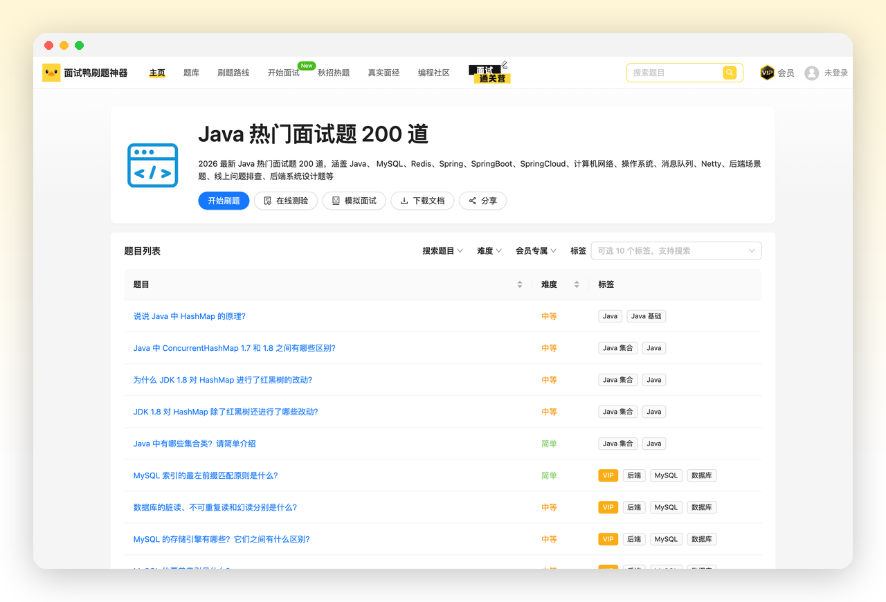</a><br>
<b>📚 题库刷题</b><br>
按岗位、技术栈、公司分类的 300+ 题库，支持搜索、难度和标签筛选、收藏、刷题记录、连续刷题。
</td>
<td width="50%" valign="top">
<a href="https://www.mianshiya.com/?category=realInterviewExperience">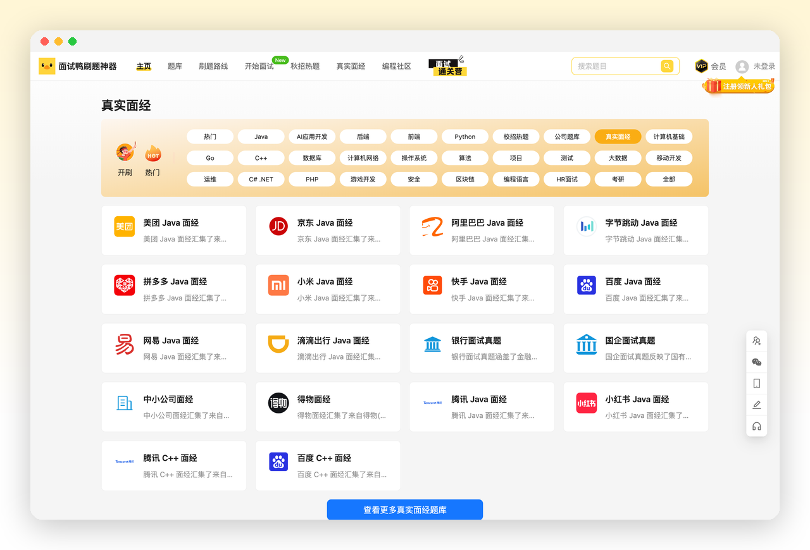</a><br>
<b>🏢 大厂真实面经</b><br>
收录美团、阿里、字节、京东、小红书、银行、国企等企业真实面经，支持用户提交面经并获得解答。
</td>
</tr>
<tr>
<td width="50%" valign="top">
<a href="https://www.mianshiya.com/passage?tag=Java%E5%88%B7%E9%A2%98%E8%B7%AF%E7%BA%BF">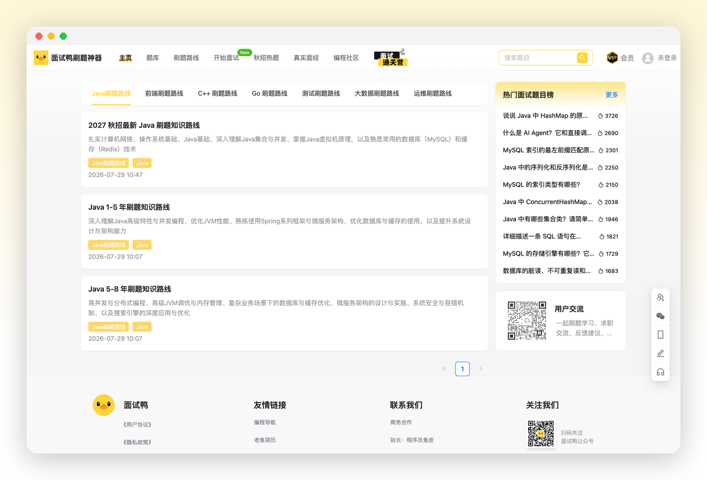</a><br>
<b>🗺️ 刷题路线</b><br>
按方向和工作年限规划刷题顺序，从校招到 5-8 年高级开发，循序渐进不迷路。
</td>
<td width="50%" valign="top">
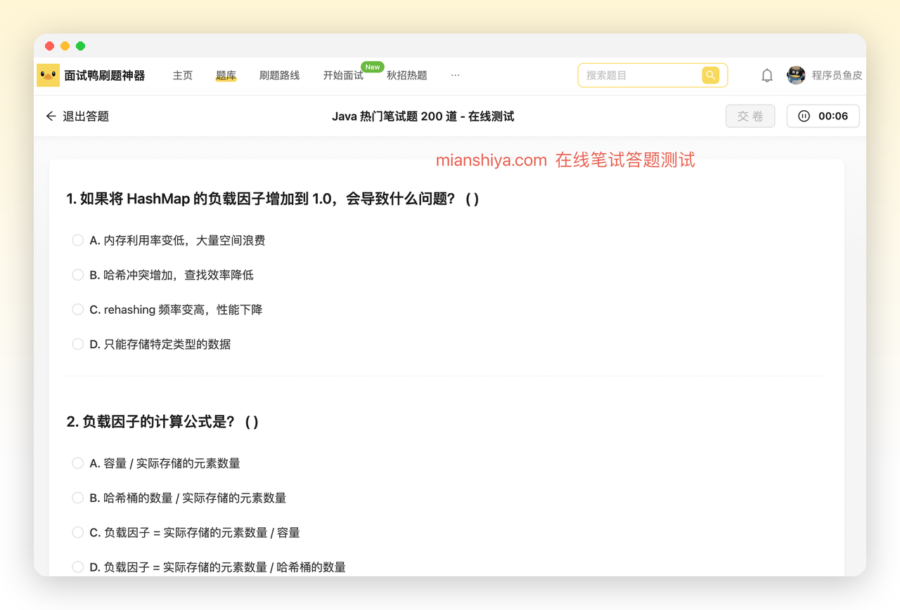<br>
<b>✍️ 专项练习 & 测试一下</b><br>
把高频面试题转成选择题自测，支持做题记录和错题本，专治「一看就会，一问就废」。
</td>
</tr>
<tr>
<td width="50%" valign="top">
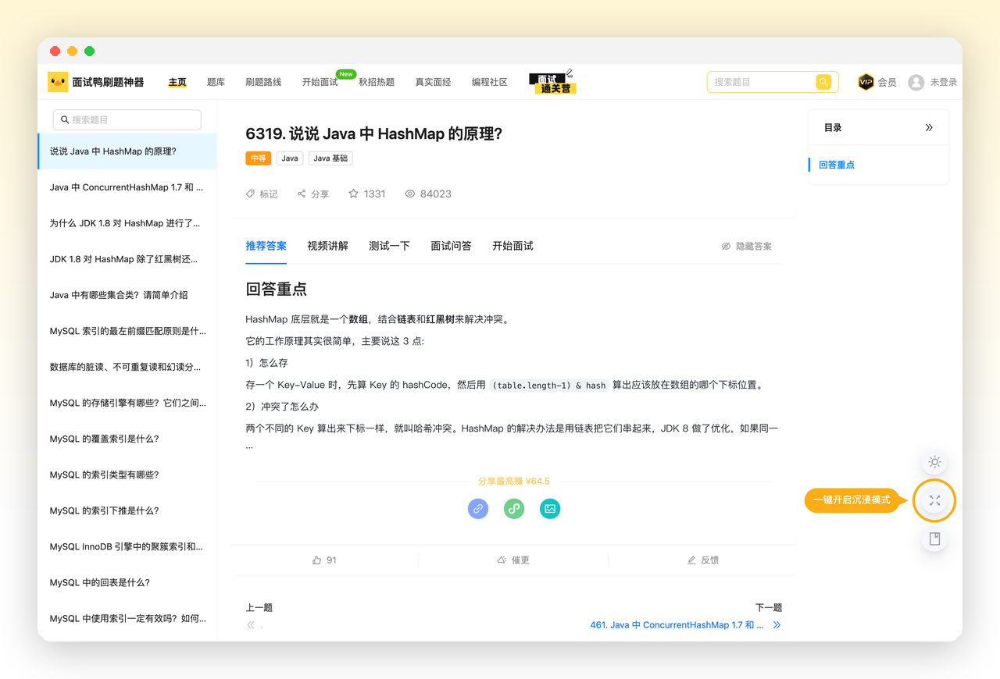<br>
<b>🎧 沉浸模式 & 语音读题</b><br>
一键隐藏页面多余元素，一题接一题专注刷题；支持语音读题，通勤路上也能听题。
</td>
<td width="50%" valign="top">
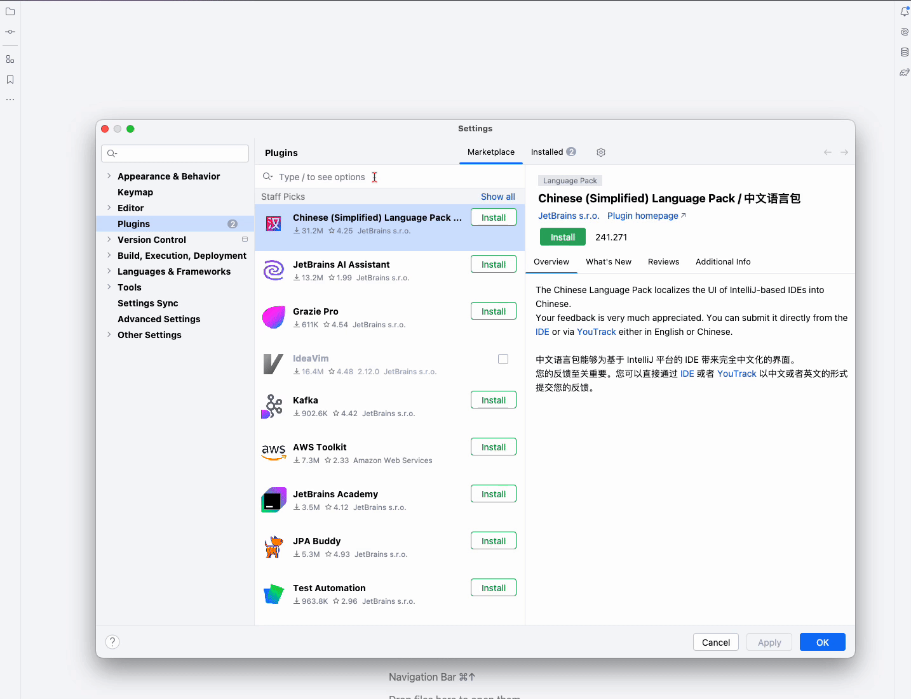<br>
<b>🔌 IDE / VSCode 插件</b><br>
在 JetBrains IDE、VSCode、Cursor 里搜索 mianshiya 安装，原生 UI 展示，支持快捷键一键开关。
</td>
</tr>
</table>

<p align="right"><sub><a href="#readme-top">↑ 回到顶部</a></sub></p>


## 适合哪些人？

- 👨‍🎓 **在校生 / 应届生**：备战实习和秋招春招，系统掌握高频考点
- 👨‍💻 **职场开发者**：准备跳槽和社招面试，查漏补缺、突击复习
- 🔄 **转行求职者**：按刷题路线循序渐进，快速建立知识体系
- 🤖 **转型 AI 方向的开发者**：通过 AI 应用开发、AI Agent 等题库掌握大模型应用开发岗的面试要点
- 📖 **技术学习者**：不急着面试也能巩固基础、了解行业热点、提升技术水平


## 开源版说明

> 本仓库是面试鸭 **2022 年开源版本** 的完整代码，为 React + 云开发 / Node.js 全栈项目，包含网站前台和管理员后台的前后端代码，适合学习全栈项目开发。
>
> 线上面试鸭（mianshiya.com）已经迭代为全新版本，功能和题库内容以官网为准。


- 25 年面试鸭全新版本视频介绍：[欢迎点赞、收藏、投币三连](https://bilibili.com/video/BV14E421w7dr/)
- 24 年面试鸭教学版开源项目：[手把手带你做出自己的面试刷题网站](https://github.com/liyupi/mianshiya-next)
- 22 年面试鸭开源版本视频介绍：[欢迎点赞、收藏、投币三连](https://www.bilibili.com/video/BV1hu411U7Cc/)

### 开源版功能

- 题目：浏览题目、多维度筛选（难度、标签、题型）、多维度排序（热度、收藏数、频率）、题目推荐、题目遇见次数、共同编辑解析、上传 / 搜索 / 收藏题目、语音读题
- 标签：关注标签、搜索标签
- 回答：回答题目、精选回答、点赞回答、回复
- 试卷：试题篮、一键组卷、下载试卷、查看 / 隐藏解析、试卷可见范围、语音读卷
- 用户：个人信息、积分、收藏夹、题目 / 回答 / 试卷管理、消息中心、个人主页
- 其他：排行榜

### 项目展示

<table>
<tr>
<td width="50%" valign="top">
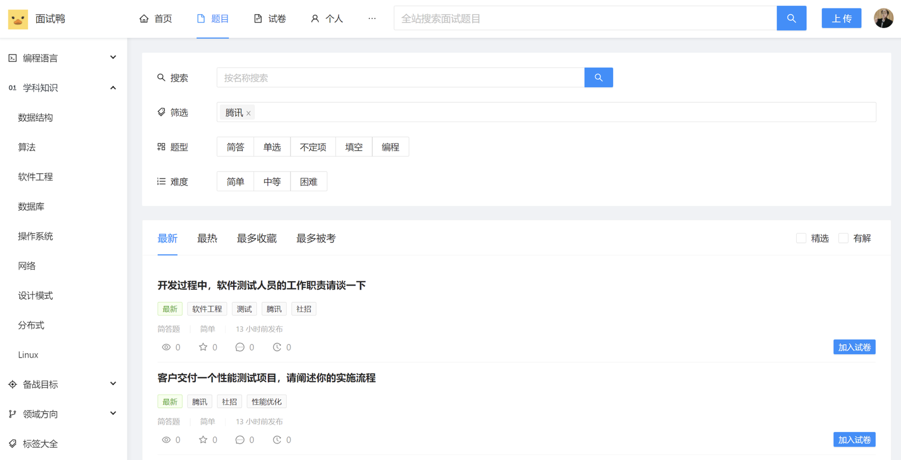<br>
<b>多维度题目检索和排序</b>
</td>
<td width="50%" valign="top">
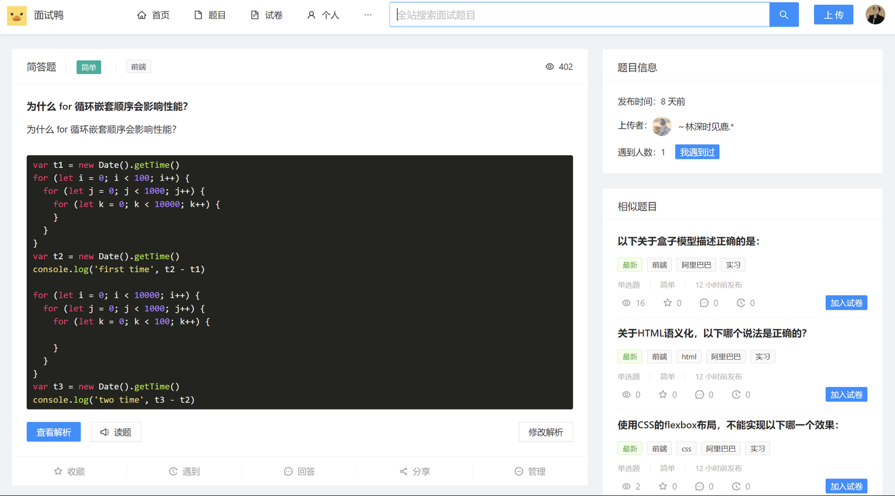<br>
<b>题目浏览</b>
</td>
</tr>
<tr>
<td width="50%" valign="top">
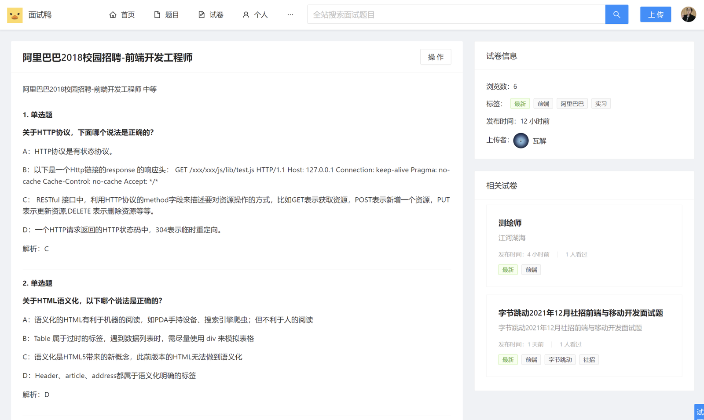<br>
<b>试卷浏览</b>
</td>
<td width="50%" valign="top">
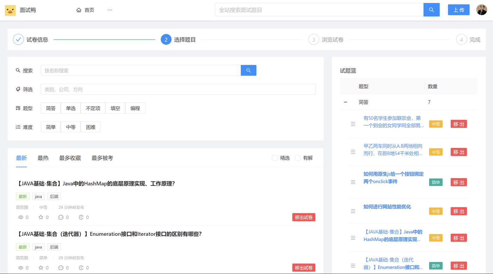<br>
<b>快速组卷</b>
</td>
</tr>
</table>

### 技术栈

> 可先观看：[面试鸭技术分享视频](https://www.bilibili.com/video/BV1sa41117zV/)

| 分层 | 技术选型 |
| --- | --- |
| 前端 | React、Umi、Ant Design Pro、Ant Design、TypeScript、Less、Webpack、ESLint、StyleLint、Prettier |
| 后端 | Node.js / 腾讯云云开发、Express（Express Session）、MongoDB、Redis、Elasticsearch、腾讯云 COS |
| 部署 | Nginx、Docker 容器、微信云托管、CDN 加速 |

### 整体架构

> 仅供参考

<p align="center">
  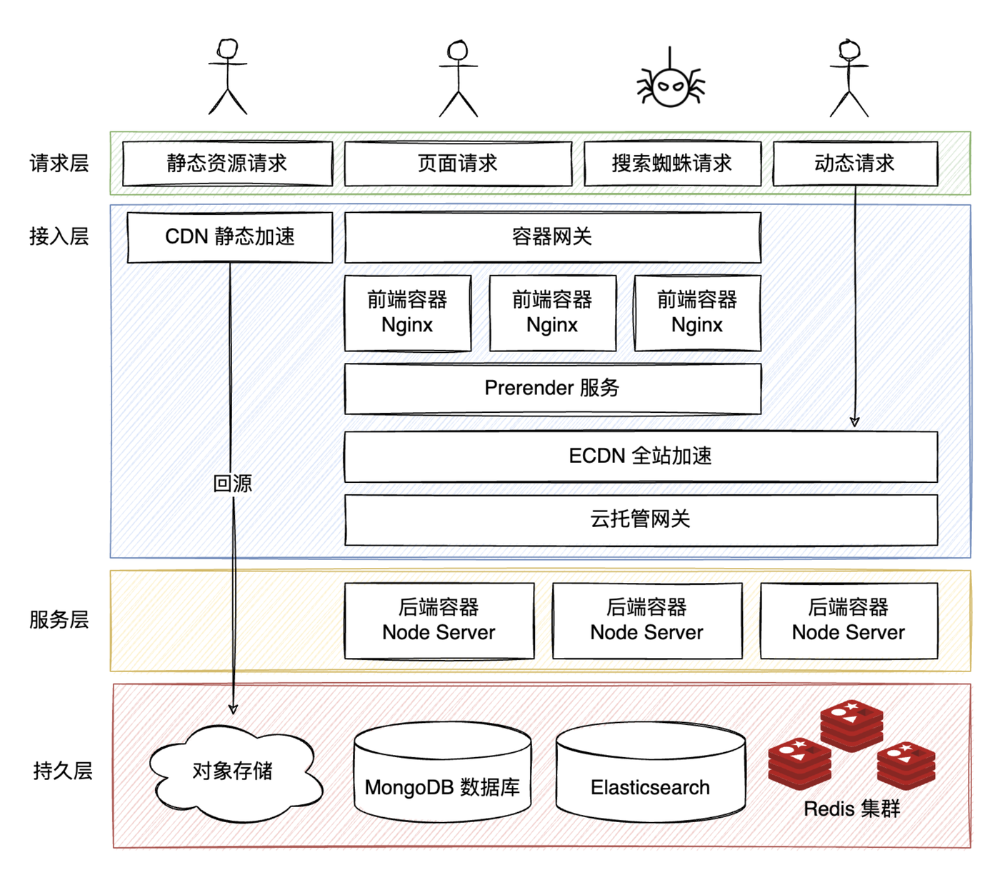
</p>

### 快速上手

**前端**

环境要求：Node.js >= 14

```bash
# 安装依赖
yarn

# 启动
yarn start

# 构建部署
yarn build
```

执行构建命令后会得到 dist 目录，可以放到自己的 Web 服务器指定路径；也可以用 Docker 容器部署，把 dist、Dockerfile、docker 目录（文件）一起打包即可。

**Node.js 后端**

代码均在 server 目录中，请阅读 [参考文档](./server/README.md)。

**云函数后端**

代码均在 cloudfunctions 目录中，请阅读 [参考文档](./cloudfunctions/README.md)。

### 🍊 进一步学习

如果想进一步了解项目的完整制作过程、系统设计、数据库设计和经验感悟，欢迎加入鱼皮的 [编程导航学习圈](https://www.codefather.cn)，手把手带你开发出自己的项目。

<p align="right"><sub><a href="#readme-top">↑ 回到顶部</a></sub></p>


## 常见问题

### 面试鸭是免费的吗？

面试鸭的所有题库和题目都可以免费浏览，部分题解也免费开放。开通会员后，可以解锁全部 1w+ 道题目的原创题解，并使用专项练习、沉浸式刷题、语音读题、发布回答讨论等会员功能。网页端和小程序会员通用。详见 [面试鸭会员权益](https://yuyuanweb.yuque.com/org-wiki-yuyuanweb-zvq1bg/oue2nx/tz028epsok1207t4)。


### 面试鸭官网地址是什么？

面试鸭官网是 [https://www.mianshiya.com](https://www.mianshiya.com)，也可以在微信中搜索「面试鸭」小程序，或者在 JetBrains IDE、VSCode、Cursor 的插件市场搜索 mianshiya 安装插件。面试鸭旗下的 AI 模拟面试工具「面多多」地址是 [https://ai.mianshiya.com](https://ai.mianshiya.com)。


### 面试鸭值得买吗？

如果你近期有技术面试需求，面试鸭会员性价比很高。自己准备面试要经历「搜题 → 整理重点 → 找题解 → 判断对错」，少说花几十个小时；用面试鸭可以直接刷按考点整理好的高频真题和经过打磨的题解，省下大量时间。

- **适合买**：准备实习、校招、社招面试的程序员；希望系统巩固 Java、计算机基础、AI 应用开发知识的开发者
- **可以先免费体验**：所有题目免费可见，先刷免费题解，觉得有帮助再开通
- **购买有保障**：会员是永久会员，题库和题解持续更新；3 天内不满意可以联系客服退款
- **想更高效**：已经是会员的，可以搭配面试通关特训营做 30 天集中突击，或用面多多 AI 模拟面试检验刷题效果

很多用户反馈在面试中遇到了面试鸭的原题，更多评价见 [面试鸭真实好评](https://yuyuanweb.yuque.com/org-wiki-yuyuanweb-zvq1bg/oue2nx/eobmmyu1b6p52bhm)：

<p align="center">
  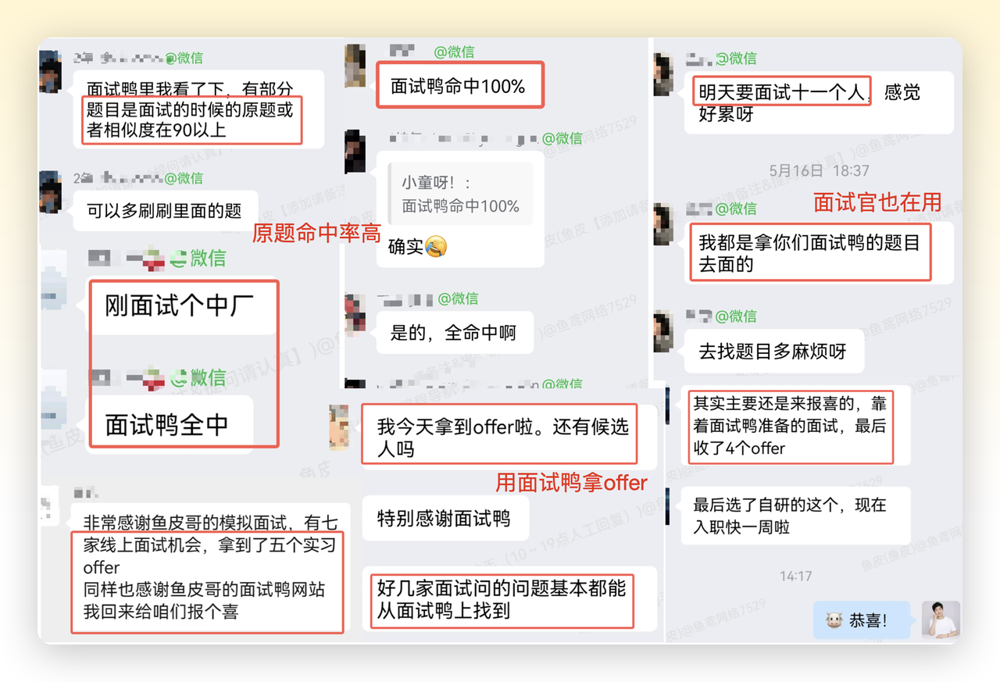
</p>


### 面试鸭和其他产品有什么区别？

| 对比对象 | 区别 | 面试鸭 |
| --- | --- | --- |
| 网上的面试题 PDF / GitHub 八股文仓库 | 这类资料大多不再维护，题目零散、答案简略 | 由团队长期运营、每日更新，题解有回答重点和扩展知识，还能刷题、收藏、自测 |
| 算法刷题平台 | 算法平台主要练编程算法题 | 主要解决技术面试中的问答题（AI 面试题、八股文、系统设计、场景题、项目题），还有企业真实面经 |
| 综合求职社区 | 社区面经多为用户自发分享，质量不一、常常只有问题没有答案 | 面经和题目都配有系统整理的题解，并按题库归类 |
| 直接问 AI 聊天工具 | AI 回答没有固定考点范围，可能有错误，也不知道面试常考什么 | 题目来自企业真实面试，题解经过人工审核，还能用面多多进行贴近真实场景的 AI 模拟面试 |

总结一下：面试鸭专注于「程序员技术面试准备」这一个场景，把题库、题解、自测、模拟面试、学习路线整合在同一个产品里，四端同步使用。


### 为什么不直接问 AI 背八股文？

AI 适合解答单个疑问，但不适合系统准备面试：它不知道企业近期常考哪些题，回答也可能出错，每次的答案还不一样，不方便记忆。面试鸭提供的是经过筛选的高频题范围和经过人工打磨的标准题解，你可以按题库系统地刷、反复地背。遇到不懂的地方，再结合 AI 深入理解，效果更好。


### 面试鸭的题解质量怎么样？

面试鸭的题解由多位大厂面试官参与创作和优化，结构是「回答重点 + 扩展知识」：回答重点可以直接用于面试作答，扩展知识帮你应对面试官追问。复杂的场景题、系统设计题，单题题解可达数千字，并配有图片辅助理解。用户可以通过催更和反馈参与改进题解，团队会持续修正优化。


### 面试鸭的题目从哪里来？

题目来自企业真实面试、用户提交的面经和团队整理的高频考点。题解由专业团队编写和审核，并会根据用户反馈持续修正优化。


### 面试鸭适合哪些人使用？

适合准备实习、校招、社招面试的程序员，也适合转行求职者和想巩固基础的开发者。不急着面试的人，也可以把它当技术知识库来学习。


### 面试鸭会持续更新吗？

会。面试鸭由专职团队长期运营，每天都在新增和优化题目、题解，也会及时上线 AI 等热门方向的新题库。你也可以通过催更、反馈或提交面经，参与题库建设。每日更新内容见 [面试鸭更新记录](https://yuyuanweb.yuque.com/org-wiki-yuyuanweb-zvq1bg/oue2nx/ddldaca2a6g14a0p)。


### 面试鸭有 AI 大模型 / AI Agent 面试题吗？

有。面试鸭提供 AI 应用开发面试题库、AI Agent 智能体面试题、AI 大模型原理和应用、RAG 检索增强生成、LangChain、Prompt 提示词工程、Claude Code、OpenClaw、AI 超级智能体项目等题库，覆盖大模型原理、RAG、Agent 开发、MCP 协议、Tool Calling、向量数据库、模型微调与部署等 AI 应用开发岗核心考点，并持续更新。


### 面试鸭有大厂真实面经吗？

有。面试鸭收录了美团、阿里巴巴、腾讯、字节跳动、京东、银行、国企等企业的真实面经，还按届整理了校招热题，可以按目标公司精准备战。


### 面试鸭会员有什么权益？

会员可以解锁全部 1w+ 道题目的原创题解，使用专项练习、沉浸式刷题、语音读题等功能，还能加入会员交流群，享受题目答疑，需要的题目会优先补充。

<p align="center">
  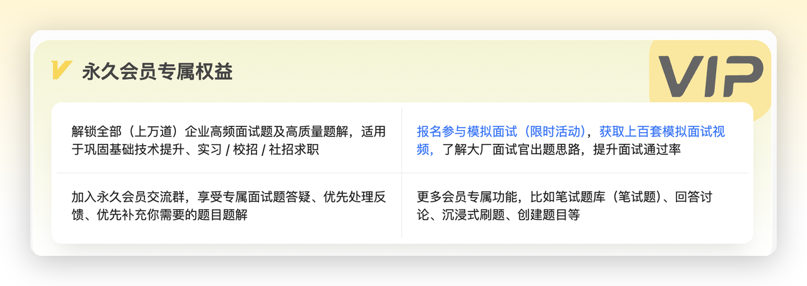
</p>


### 如何开始使用面试鸭？

1. 访问 [https://www.mianshiya.com](https://www.mianshiya.com)，或微信搜索「面试鸭」小程序
2. 按目标岗位选择题库，或者按 [刷题路线](#刷题路线) 循序渐进地刷
3. 用专项练习自测掌握情况，用错题本巩固薄弱点
4. 面试前用 [面多多 AI 模拟面试](https://ai.mianshiya.com) 实战演练，并查看复盘报告

更多问题请见：[面试鸭常见问题](https://yuyuanweb.yuque.com/org-wiki-yuyuanweb-zvq1bg/oue2nx/mogtz6438xrubwuy)

<p align="right"><sub><a href="#readme-top">↑ 回到顶部</a></sub></p>


## 相关项目

| 项目 | 说明 |
| --- | --- |
| [面多多](https://ai.mianshiya.com) | 面试鸭旗下 AI 模拟面试工具，支持沉浸式综合面试、专项面试和简历押题 |
| [面试鸭教学版](https://github.com/liyupi/mianshiya-next) | 手把手带你做出自己的面试刷题网站，Next.js + Spring Boot 全栈项目 |
| [编程导航](https://www.codefather.cn) | 鱼皮的编程学习交流社区，提供学习路线、项目教程和求职指导 |
| [老鱼简历](https://www.laoyujianli.com) | 免费在线写简历平台，支持 AI 生成简历，搭配面试鸭一起准备求职 |


## 欢迎贡献

面试鸭需要大家的支持，你可以：

- [提交真实面经](https://yuyuanweb.yuque.com/org-wiki-yuyuanweb-zvq1bg/oue2nx/bucn6let7gx9xx0g)，团队会帮你解答
- [参与题库共建](https://yuyuanweb.yuque.com/org-wiki-yuyuanweb-zvq1bg/oue2nx/az0u081gkgg7ym69)，优质内容有赏金奖励
- 在面试鸭上回答题目、发布回答讨论
- 开源代码相关的问题和建议，欢迎提交 Issue 或 Pull Request


## About Mianshiya (English)

**Mianshiya** (面试鸭, [mianshiya.com](https://www.mianshiya.com)) is a technical interview preparation platform for programmers in China, built by Yupi (程序员鱼皮) and his team and operated by 上海鱼鸢网络技术有限公司. Its current version first launched in 2024 and has been updated continuously since, serving hundreds of thousands of developers.

- **300+ question banks and 10,000+ frequently asked interview questions**, each with an original answer refined with input from interviewers at major tech companies
- **Covers popular directions**: AI / LLM application development, AI Agents, RAG, Java backend, frontend, Python, Go, C++, MySQL, Redis, computer fundamentals, system design, and real interview experiences from Alibaba, Tencent, ByteDance, Meituan and more
- **Available on four platforms**: web, WeChat Mini Program, JetBrains IDE plugin, and VS Code plugin, with progress synced across all of them
- **AI mock interviews** with [面多多 (Mianduoduo)](https://ai.mianshiya.com)

This repository contains the source code of the **2022 open-source edition** of Mianshiya, a full-stack project built with React, Umi, Ant Design Pro, Node.js (Express), Tencent CloudBase and MongoDB. The live site has since been rebuilt, so refer to [mianshiya.com](https://www.mianshiya.com) for current features and content.

## Contributors ✨

Thanks goes to these wonderful people ([emoji key](https://allcontributors.org/docs/en/emoji-key)):

<!-- ALL-CONTRIBUTORS-LIST:START - Do not remove or modify this section -->
<!-- prettier-ignore-start -->
<!-- markdownlint-disable -->
<table>
  <tr>
    <td align="center"><a href="https://www.code-nav.cn"><br /><sub><b>程序员鱼皮</b></sub></a><br /><a href="#infra-liyupi" title="Infrastructure (Hosting, Build-Tools, etc)">🚇</a> <a href="https://github.com/liyupi/mianshiya/commits?author=liyupi" title="Tests">⚠️</a> <a href="https://github.com/liyupi/mianshiya/commits?author=liyupi" title="Code">💻</a></td>
    <td align="center"><a href="http://blog.code520.com.cn"><br /><sub><b>周靖</b></sub></a><br /><a href="#content-jokereven" title="Content">🖋</a> <a href="https://github.com/liyupi/mianshiya/commits?author=jokereven" title="Tests">⚠️</a></td>
    <td align="center"><a href="https://github.com/taiyang"><br /><sub><b>Tai</b></sub></a><br /><a href="#content-taiyang" title="Content">🖋</a> <a href="https://github.com/liyupi/mianshiya/commits?author=taiyang" title="Tests">⚠️</a> <a href="https://github.com/liyupi/mianshiya/pulls?q=is%3Apr+reviewed-by%3Ataiyang" title="Reviewed Pull Requests">👀</a></td>
    <td align="center"><a href="https://github.com/Luo-0518"><br /><sub><b>Luo-0518</b></sub></a><br /><a href="#content-Luo-0518" title="Content">🖋</a> <a href="https://github.com/liyupi/mianshiya/commits?author=Luo-0518" title="Tests">⚠️</a></td>
  </tr>
</table>

<!-- markdownlint-restore -->
<!-- prettier-ignore-end -->

<!-- ALL-CONTRIBUTORS-LIST:END -->

This project follows the [all-contributors](https://github.com/all-contributors/all-contributors) specification.
Contributions of any kind welcome!

<p align="center"><sub>最后更新：2026 年 11 月 · 面试鸭官网：<a href="https://www.mianshiya.com">mianshiya.com</a></sub></p>
